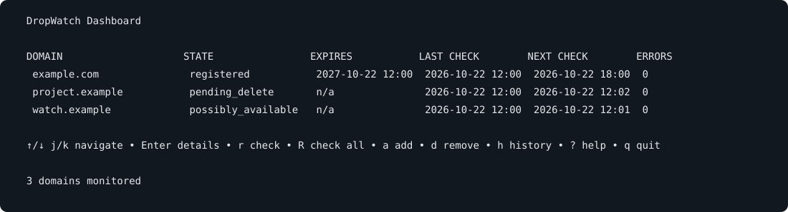

# DropWatch

[](https://github.com/Simplarix/dropwatch/actions/workflows/ci.yml)
[](https://github.com/Simplarix/dropwatch/actions/workflows/security.yml)
[](https://github.com/Simplarix/dropwatch/releases)
[](LICENSE)

Watch domains you care about and receive notifications when their registration state changes. DropWatch is a self-hosted domain watcher maintained by [Simplarix](https://github.com/Simplarix), with RDAP checks, SQLite history, and Discord or email notifications.

A single Go binary provides a scriptable CLI, an interactive terminal dashboard, and a background watcher. DNS is a supporting signal; availability requires repeated authoritative observations. DropWatch does not register domains or guarantee that a registrar will accept a registration.



*Dashboard preview with synthetic sample data.*

## Features

- Unicode-domain and Punycode normalization through IDNA
- IANA RDAP bootstrap discovery with local caching and last-known-good fallback
- RDAP status, registrar, expiration-date, and nameserver tracking
- supplementary NS, SOA, A, AAAA, and MX lookups
- conservative availability decisions with multiple time-separated confirmations
- adaptive intervals, jitter, exponential backoff, and `Retry-After` support
- SQLite with WAL, embedded migrations, foreign keys, and durable history
- deduplicated Discord and SMTP delivery with attempt history
- exclusive watcher lease, heartbeat, bounded concurrency, and graceful shutdown
- Bubble Tea terminal dashboard
- small hardened multi-architecture container and tag-gated GHCR release workflow

## Installation

### Linux binary

Download `dropwatch-linux-amd64` or `dropwatch-linux-arm64` and `checksums.txt` from the [latest release](https://github.com/Simplarix/dropwatch/releases/latest). In the download directory, verify the selected binary and make it executable:

```bash
sha256sum --check --ignore-missing checksums.txt
chmod +x dropwatch-linux-amd64
./dropwatch-linux-amd64 version
```

For ARM64, use `dropwatch-linux-arm64` instead. Move the verified binary to a directory on your `PATH` and name it `dropwatch` to use the commands below. Release binaries target Linux; on macOS or other Go-supported systems, build from source.

### Go or source checkout

With Go 1.26.10 or newer:

```bash
go install github.com/Simplarix/dropwatch/cmd/dropwatch@latest
```

Make sure your Go binary directory (normally `$(go env GOPATH)/bin`) is on your `PATH`. Alternatively, clone and build:

```bash
git clone https://github.com/Simplarix/dropwatch.git
cd dropwatch
make build
./dropwatch version
```

For a background container deployment, see [Docker](#docker).

## Quick start

```bash
dropwatch init --write-config
dropwatch domain add example.com
dropwatch domain add example.net
dropwatch domain list
dropwatch domain show example.com
dropwatch check example.com
dropwatch history example.com --limit 100
dropwatch dashboard
```

Machine-readable commands support `--json`; automation can use `--quiet`. A network or registry failure makes `check` return a non-zero exit status, but it never marks a domain as available.

Keep the watcher running to perform scheduled checks and deliver change notifications:

```bash
dropwatch watch
```

`SIGINT` and `SIGTERM` trigger a graceful shutdown. Only one watcher may own a database at a time.

Open `dropwatch dashboard` in another terminal while the watcher runs. The dashboard displays stored state and supports manual checks; opening it alone does not start the background watcher. Configure Discord or SMTP in the [configuration](#configuration) and run `dropwatch notify test` to verify delivery.

## CLI

```text
dropwatch init [--write-config]
dropwatch domain add DOMAIN [--no-check]
dropwatch domain remove DOMAIN
dropwatch domain list [--json]
dropwatch domain show DOMAIN [--json]
dropwatch check DOMAIN [--json]
dropwatch check --all [--json]
dropwatch history DOMAIN [--limit N] [--json]
dropwatch watch
dropwatch dashboard
dropwatch notify test
dropwatch health [--json]
dropwatch version [--json]
```

Global flags such as `--database`, `--config`, `--timezone`, `--max-concurrency`, `--http-timeout`, `--log-level`, and `--log-format` override configuration values.

Dashboard keys:

```text
↑/↓ or j/k   Navigate
Enter        Open details
r            Check the selected domain
R            Check every domain
a            Add a domain
d            Remove with confirmation
h            Show history
?            Show help
q            Quit
```

## Configuration

Configuration precedence is:

```text
CLI flag > DROPWATCH_ environment variable > YAML > default
```

See [config.example.yaml](config.example.yaml) for a complete YAML example and [.env.example](.env.example) for container variables. Supported environment variables include:

- `DROPWATCH_DATABASE_PATH`
- `DROPWATCH_CONFIG_PATH`
- `DROPWATCH_LOG_LEVEL`
- `DROPWATCH_LOG_FORMAT`
- `DROPWATCH_TIMEZONE`
- `DROPWATCH_MAX_CONCURRENCY`
- `DROPWATCH_HTTP_TIMEOUT`
- `DROPWATCH_DISCORD_WEBHOOK_URL`
- `DROPWATCH_SMTP_HOST`, `DROPWATCH_SMTP_PORT`
- `DROPWATCH_SMTP_USERNAME`, `DROPWATCH_SMTP_PASSWORD`
- `DROPWATCH_SMTP_FROM`, `DROPWATCH_SMTP_TO`
- `DROPWATCH_SMTP_REQUIRE_TLS`

All timestamps are stored in UTC. `timezone` only changes human-readable output. Credentials belong in an untracked environment or the deployment platform's secret store. Remote RDAP bootstrap and service URLs must use public HTTPS endpoints. SMTP requires STARTTLS except for explicit loopback-only test servers.

## Availability and safety model

RDAP is the primary source. DNS failures are supporting information and never prove availability. An authoritative RDAP 404 first produces `possibly_available`. By default, three confirmations separated by at least one minute are required before the state becomes `available`. Any registration signal wins when providers disagree.

`clientHold`, missing DNS records, timeouts, HTTP 429, and HTTP 5xx explicitly do not mean that a domain is available. Provider extension guidance is in [docs/providers.md](docs/providers.md).

DropWatch does not guarantee domain registration. RDAP and DNS results are not a legal or technical commitment from a registrar. Registry policy, reserved or premium names, registrar-specific restrictions, and state changes between observation and registration can all affect the outcome.

## Docker

Download `image-digest.txt` from the [release](https://github.com/Simplarix/dropwatch/releases/latest) you want to run. It contains the complete immutable GHCR image reference. No registry account is needed to pull the public image.

From a checkout, use Compose:

```bash
cp .env.example .env
# Replace DROPWATCH_IMAGE in .env with the exact line from image-digest.txt.
docker compose -f compose.production.yml up -d
docker compose -f compose.production.yml exec dropwatch dropwatch domain add example.com
docker compose -f compose.production.yml exec dropwatch dropwatch domain list
```

Use the exact `ghcr.io/simplarix/dropwatch@sha256:...` digest from the release's `image-digest.txt`; floating tags such as `latest` are intentionally unsupported for production. The Compose file explicitly passes only the documented DropWatch settings from `.env` or the deployment platform into the container. [compose.production.yml](compose.production.yml) uses a read-only root filesystem, drops every Linux capability, enables `no-new-privileges`, limits resources and logs, and exposes no port. Its image healthcheck calls `dropwatch health --quiet`.

The `/data` volume contains SQLite data and the RDAP bootstrap cache. Back it up using a SQLite-aware snapshot or while the container is stopped; do not copy individual WAL files independently.

To build the container locally, run `make docker-build`. The [Dokploy deployment guide](docs/dokploy.md) covers release verification, environment settings, backups, and manual rollout.

## Development and contributions

Bug reports and focused pull requests are welcome. See [CONTRIBUTING.md](CONTRIBUTING.md) for the workflow and [SECURITY.md](SECURITY.md) for private vulnerability reporting.

Development requires Go 1.26.10 or newer and a C compiler for race tests. Docker is needed for container checks. From a checkout, run:

```bash
make verify
make smoke
```

`make verify` checks modules and formatting, runs `go vet` and the full race test suite, and builds the application. `make smoke` checks the CLI, watcher, storage, and health without internet access. Optional `make smoke-live` also checks real IANA, RDAP, and DNS services. See [docs/testing.md](docs/testing.md) for focused checks.

## Architecture and agent-assisted development

- [docs/architecture.md](docs/architecture.md) explains package boundaries and data flow.
- [docs/testing.md](docs/testing.md) describes deterministic and live validation.
- [docs/agentic-development.md](docs/agentic-development.md) explains how Codex, Claude Code, and GitHub Copilot are configured.
- [AGENTS.md](AGENTS.md) is the repository-wide source of truth for coding agents.
- [REVIEW.md](REVIEW.md) contains the security and correctness review checklist.

## Security checks, release, and Dokploy

Run `make security` for reachable Go vulnerability checks, static security analysis, repository configuration scanning, and a full image CVE scan. GitHub repeats these checks for pull requests, `main`, and weekly schedules; Dependabot monitors Go modules, Actions, and Docker references.

A normal push to `main` runs CI only. Only a newly pushed stable tag in the exact form `vX.Y.Z`, whose commit belongs to `main`, creates the GitHub Release and multi-architecture image with provenance and an SBOM. Deployment remains deliberately private and manual; the GitHub-hosted runner never contacts Dokploy. The exact GitHub, GHCR, Dokploy, backup, and verification procedure is in [docs/dokploy.md](docs/dokploy.md).

## License

DropWatch is [MIT licensed](LICENSE). Third-party dependencies retain their respective licenses.
